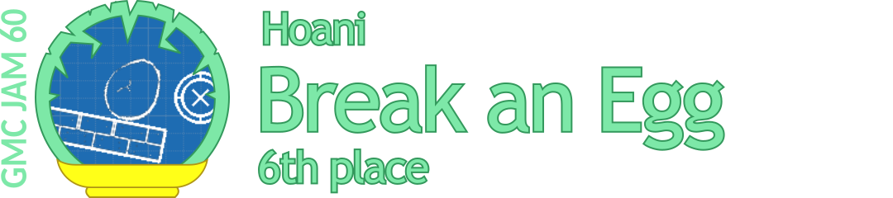

Skelletrex and his bone brigade have enslaved the human race. They are taking people's bones to make more bone soldiers.

The human revolution have intel that Skelletrex is hosting a local martial arts tournament in his garage. Defeat Skelletrex at his tournament and save the human race.

**About**

This game was made in five days as an entry to the GMC Jam 60. 

The theme of the Jam was `Hard to Crack`.

I wanted to make a game where players can be creative and share thier creations.



## Awards

<figure style="margin-bottom:0"></figure> 

## Credits

Design, Software, Art, Modelling
by **Hoani Bryson**

Sound
by **** (via GameDevMarket)

Fonts
by **Chequered Ink** and **HawtPixel**
